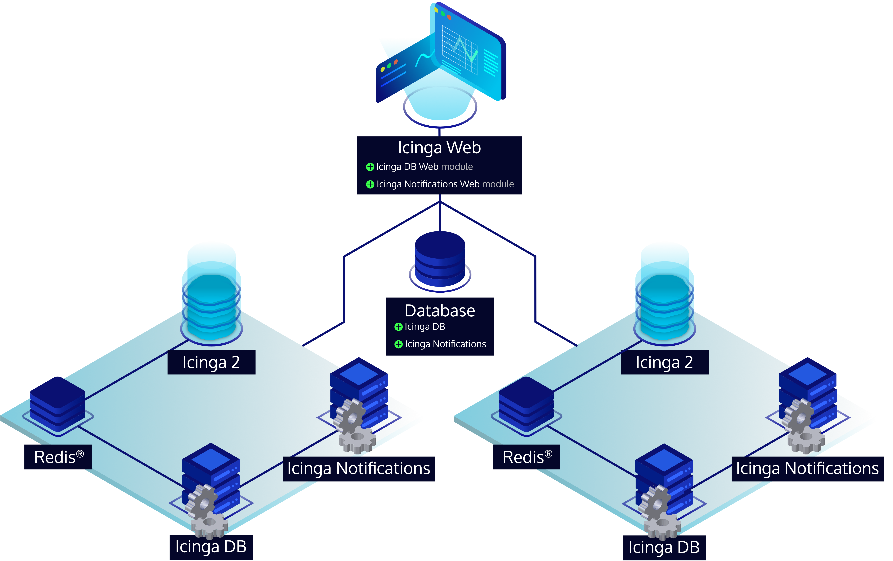

# Distributed Setups

Icinga Notifications can run as multiple daemon instances that share a single relational database.
This is useful if you want to keep sending notifications when a server fails, or if you want to spread a high
volume of events across several servers.

All instances accept events, share the processing load, and keep working if one of them becomes unavailable.
There is no primary instance and no leader election; all instances are equal.

## Setting up Additional Instances

- [Install](02-Installation.md) Icinga Notifications on the new server, using the same version as the existing instances.
  See [Upgrading](#upgrading) for what happens while versions differ.
- Configure the [database connection](03-Configuration.md#database-configuration) to use the existing shared database.
  All configuration and all event processing go through it, so every instance must be able to reach it. Do **not**
  import the database schema again, as it already exists.
- Install the same [channel plugins](10-Channels.md) as on the existing instances in the
  [channels directory](03-Configuration.md#channels-directory). Any instance may send any notification, not only the
  one that received the triggering event.
- Synchronize the server's clock with the other servers, for example via NTP. Events are processed in the
  order in which they were stored in the database, so clock drift between servers can lead to events being processed
  out of order.
- Start Icinga Notifications.

No further settings are needed. There is no cluster configuration and no registration step:
an instance becomes part of the setup simply by connecting to the shared database.

## Icinga HA Setup

Most users run Icinga Notifications next to a
[distributed Icinga 2](https://icinga.com/docs/icinga-2/latest/doc/06-distributed-monitoring/#high-availability-master-with-agents)
setup with a
[distributed Icinga DB](https://icinga.com/docs/icinga-db/latest/doc/05-Distributed-Setups/).
The following picture shows the recommended layout for such an environment.

_Two servers, each running the full chain of components, sharing one relational database._

The setup consists of two servers (physical or virtual machines), each running Icinga 2, Icinga DB,
Icinga Notifications, and a Redis®[\*](TRADEMARKS.md#redis) daemon side by side. On each server, these components
form a self-contained chain:

- Icinga 2 writes its monitoring state to Redis®. 
- Icinga DB reads it from there.
- Icinga DB forwards the resulting events to Icinga Notifications.

!!! important

    Each component should only talk to the next one in the chain on the same server, never to its counterpart on the
    other server. In particular, configure each Icinga DB to send its events to the Icinga Notifications instance
    on its own server, via a local Unix socket.

Both the Icinga DB and the Icinga Notifications instance pairs must share the same relational database.
Since every other component depends on it, the database should ideally be highly available as well.

Icinga DB and Icinga Notifications handle high availability differently:

|                          | Icinga DB                                    | Icinga Notifications                                      |
|--------------------------|----------------------------------------------|-----------------------------------------------------------|
| Instances active at once | One, the other one is paused                 | All                                                       |
| Failover                 | The paused instance takes over automatically | Not needed                                                |
| Events                   | Only the active instance sends events        | Each instance accepts events from Icinga DB on its server |

So at any time, only the active Icinga DB instance sends events, and it sends them to the Icinga Notifications instance
on its own server. How both Icinga Notifications instances then share the work is described in the following
[How Instances Work Together](#how-instances-work-together) section.

If Icinga DB submits its events via a [Unix socket](03-Configuration.md#http-api-configuration), the Icinga DB OS user
must have the same name on both servers, as it has to match the username configured for the source.

In addition, Icinga Web 2, Icinga DB Web, and Icinga Notifications Web must be able to access the relational database
as well as both Redis® instances, so that the web interface keeps working regardless of which server is down.

## How Instances Work Together

This section describes what happens in the background. You do not need to know these details to run a distributed setup,
but they help in understanding its behavior.

When an instance receives an event via the [HTTP API](20-HTTP-API.md), it does not process the event right away.
Instead, it stores the event in a queue, the `job_queue` table in the database, and responds with `204 No Content` as
soon as the event is stored. From that moment on, the event is safe, even if the receiving instance crashes.
Actions taken in Icinga Notifications Web, such as managing or subscribing to an incident, go through the same queue.

Each instance continuously checks this queue for pending events. The database ensures that only one instance picks up
each event. Additionally, events belonging to the same object, for example the same host or service, are never 
processed at the same time, not even by different instances. Events for different objects are processed in parallel,
up to four at a time per instance. As a result, the instance that processes an event is not necessarily the one that
received it.

Every queued event has a unique ID. If a source submits the same event again, for example after a network timeout,
the duplicate is ignored. Processed events are kept in the queue for a few minutes so that such late resubmissions
are recognized as well.

### Load Balancing

The HTTP API of each instance works independently. In the [Icinga HA setup](#icinga-ha-setup), each Icinga DB sends its
events to the Icinga Notifications instance on its own server, so no load balancer is needed there.

Other sources can either be pointed at a specific instance or at a load balancer in front of all instances.
Since every event ends up in the shared queue, it does not matter which instance receives it. The load balancer may
use any distribution strategy and does not need to send a source's requests to the same instance every time.

### Failure Handling

* **An instance stops or crashes:** The remaining instances continue processing new events. Events that the failed
  instance was processing at that moment are released after about five minutes and are then picked up by another
  instance. Such an event may be processed twice, which can result in a duplicate notification.
* **Processing an event fails or takes longer than one minute:** The event is marked as failed and is not retried.
  Icinga Notifications logs an error message containing `Failed to process event` and the ID of the event.
* **The database is temporarily unreachable:** All instances keep retrying, waiting a bit longer after each attempt,
  and resume normal operation once the database is available again.

## Upgrading

Since all instances share one database, a [database schema upgrade](04-Upgrading.md#database-schema-upgrades)
is applied only once, from any server.

If the new version requires a schema upgrade:

1. Stop Icinga Notifications on all servers.
2. Apply the schema upgrade once.
3. Upgrade Icinga Notifications on all servers.
4. Start Icinga Notifications on all servers.

If the new version does not require a schema upgrade, you can upgrade the instances one after another while the
others keep running.

While versions differ, an older instance may find a queued event that was stored in a newer format it does not 
understand yet. It then leaves the event untouched and logs a warning, so that an already upgraded instance can
process it. No events are lost this way, but older instances stop helping with processing until they are upgraded
as well. So do not leave instances on different versions longer than necessary.

## Troubleshooting

### Corrupt Queue Entries

The event queue is used internally by Icinga Notifications only. No external process may insert events into it, so it
is expected to only contain valid data.

Nevertheless, in the unlikely case that corrupted data crept into the `job_queue` table, Icinga Notifications will log
an error and mark the entry as failed (`state = 64`). The log message contains the `id` of the invalid `job_queue` row,
so you can inspect the entry in the database and then fix or delete it. Failed entries are removed automatically after
24 hours, independent of the configured [retention](03-Configuration.md#retention-configuration) policy.
